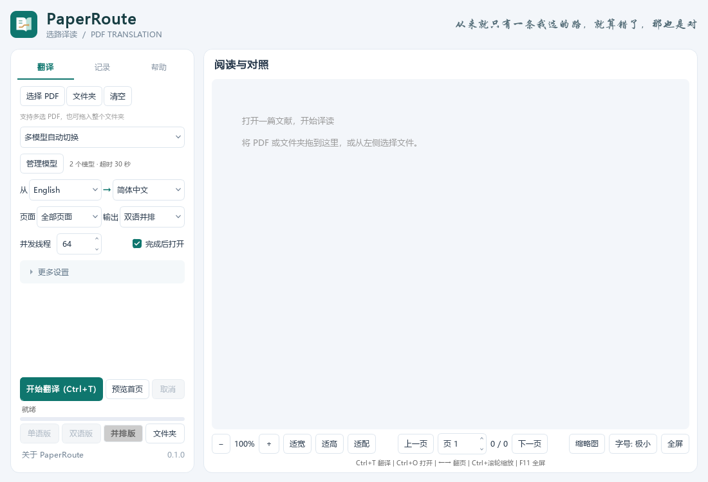

# PaperRoute · 选路译读

一个专注 PDF 阅读与翻译的 Windows 桌面改版。支持批量翻译、多模型故障切换，以及阿里云百炼等 OpenAI 兼容服务。

> 从来就只有一条我选的路，就算错了，那也是对

[下载 Windows 单文件版](https://github.com/508liang/PaperRoute/releases/tag/v0.1.0) · [阿里云配置指南](docs/ALIYUN.md) · [来源与许可](THIRD_PARTY_NOTICES.md)

## 开始使用

1. 从 Releases 下载 `PaperRoute.exe`，双击运行；首次会展开本地运行环境，后续复用。
2. 点击「管理模型」添加候选；使用阿里云时点击「添加阿里云」，填入自己的百炼 API Key。
3. 点击绿色「保存并启用多模型翻译」。可加入不同模型、平台和密钥作为备用。
4. 选择 PDF，先用「预览首页」检查效果，再翻译全文。

按 Ctrl / Shift 可多选 PDF；也可加入整个文件夹及子目录。程序依次处理文件，文件内部按线程数并发翻译。

## 阿里云百炼示例

北京地域可以使用以下配置：

| 配置项 | 示例 |
| --- | --- |
| API 地址 | `https://dashscope.aliyuncs.com/compatible-mode/v1` |
| 模型名 | `qwen-plus`，可复制一行改为 `qwen-flash` 作为备用 |
| API Key | 自己在同地域百炼控制台创建的 Key |
| 关闭思考 | 这两个示例模型可勾选 |

阿里云目前推荐业务空间专属域名，例如北京地域的 `https://{WorkspaceId}.cn-beijing.maas.aliyuncs.com/compatible-mode/v1`；也可直接复制控制台给出的地址。上表旧域名仍兼容，接口地址和 Key 必须对应同一地域，详见[阿里云官方文档](https://help.aliyun.com/zh/model-studio/compatibility-of-openai-with-dashscope)。

完整步骤、备用模型、限流和常见报错见 [docs/ALIYUN.md](docs/ALIYUN.md)。模型可用性、价格与额度以百炼控制台为准。

## 主要功能

- **自动故障切换**：段落请求超时、报错或空回复时，尝试下一个候选。
- **独立控制并发和限速**：1–256 个段落线程；每秒请求数、总时限和故障冷却单独设置。
- **保留已完成的工作**：段落缓存可复用；全部候选不可用时明确停止。
- **批量翻译与预览**：支持多选、文件夹，以及单语、双语交替和左右并排 PDF。
- **简洁界面与保存提醒**：窄侧栏、花体标语、折叠设置；模型配置未保存时关闭会提醒。
- **精简单文件包**：排除 Zotero 联动、宣传素材、无用 Qt 模块和依赖开发文件；不开启上游自动更新。

普通可选择文字的论文一般保持默认即可。扫描件识别、表格补充翻译、长文档分段及字体兼容选项仍保留。

## 数据与构建

单文件版约 212 MiB，包含 Python、翻译依赖、版面模型和简体中文译文字体。首次展开到 `%LOCALAPPDATA%/PaperRoute/runtime/`；配置、历史、日志和译文存放在 `%LOCALAPPDATA%/PaperRoute/`，更换 exe 不会覆盖已有配置。可从界面的「文件夹」打开译文目录。

首次在已有完整便携目录旁运行时，可导入相邻安装的本地配置。单文件本身不包含任何人的 API Key 或 PDF。翻译需要所选模型服务；其他语种字体和部分 OCR 模型可能首次使用时下载。

本机密钥沿用 Base64 存储，Base64 不是加密。不要上传个人 `config/local_*.json`、论文、译文、日志和历史。

仓库提供源码、构建脚本和测试；数百 MB 的运行库和 exe 放在 Releases。构建及依赖说明见 [docs/BUILDING.md](docs/BUILDING.md)。

## 来源与许可

PaperRoute 由 [@508liang](https://github.com/508liang) 与 Codex 协作二次开发，主要增加模型故障切换、并发管理、界面重设计、阿里云配置入口与精简单文件打包。

翻译核心基于 [PDFMathTranslate](https://github.com/PDFMathTranslate/PDFMathTranslate)；Windows 桌面代码基于 [AaronGIG/pdf2zh-desktop](https://github.com/AaronGIG/pdf2zh-desktop) 改造，排版相关组件包括 [BabelDOC](https://github.com/funstory-ai/BabelDOC)。感谢原作者和贡献者。本项目为独立衍生版本。

核心组件和新增代码的许可证资料随仓库提供。原桌面外壳的独立许可未在检查的上游仓库中找到，本文不将其授权状态描述为已确认，也不通过根目录 LICENSE 重新许可第三方代码。完整范围见 [LICENSE_SCOPE.md](LICENSE_SCOPE.md)、[THIRD_PARTY_NOTICES.md](THIRD_PARTY_NOTICES.md) 与 [发布说明](PUBLISHING.md)。
